---
tags:
- rmt
- websocket
- session
- filter
- graph
- pid
- log
- metrics
- pipeline
- widget
- history
---

# Before you start {:data-level="all"}

This tutorial starts where [Remote monitoring](remote-monitoring) stops. You know how to start a session with `-rmt` and open the monitoring interface; here you learn to read what it shows, step by step, on a real session.

Start the encoding and DASH packaging example of [Live monitoring](remote-monitoring#live-monitoring) and keep it running during the whole tutorial.

# 1. Get the session on screen {:data-level="all"}

Show the running session:

- click the reload button at the left of the connection selector

The whole session appears.

<figure markdown="span">
  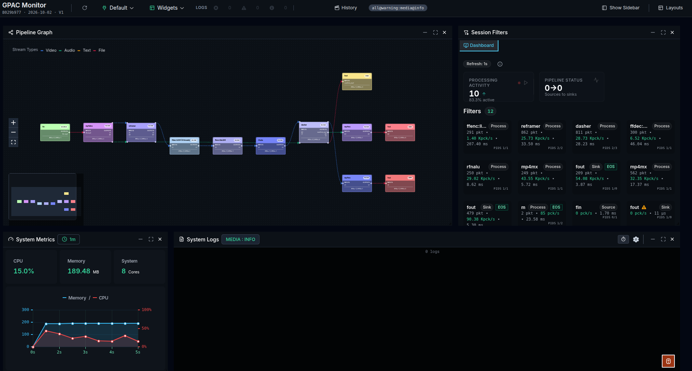
</figure>

# 2. Compare the graph with your command {:data-level="all"}

The **Pipeline Graph** shows more filters than your command names: the extra ones were created implicitly by GPAC to resolve the graph.

Each edge is a connection between two filters, and its color tells which kind of stream it carries: green for audio, blue for video, yellow for text, red for files. At a glance, you see which stream travels through each connection: 

<figure markdown="span">
  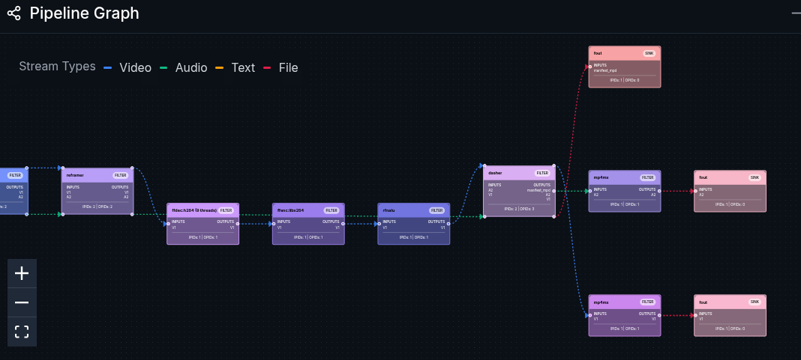
</figure>

# 3. Open the encoder {:data-level="all"}

Open the encoder:

- click the encoder node in the graph

The filter opens in its own tab of the **Session Filters** widget, on its Overview tab, next to the Dashboard that lists every filter of the session.

<figure markdown="span">
  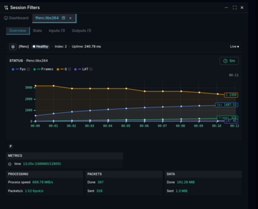
</figure>

Browse the filter:

- switch between its four tabs

Overview summarizes what the filter reports (refreshed every second): its status, packets and data. Stats shows the bytes it receives and sends per second, with a chart over a time window you choose. Inputs and Outputs list the PIDs entering and leaving the filter, their number shown in the tab name.

The Status chart plots the values the encoder reports, such as **Fps**, **Frames**, **Q** (quality of the last frame) and **LAT** (internal latency: the number of frames the encoder holds, received but not yet output).

Follow only **Fps**:

- click every other name in the legend to hide its curve
- click a hidden name again to show its curve
- hover the info icon next to a name to read what it measures

Below the chart, the P badge shows the type of the last encoded frame (I, P or B). The Packets card counts the packets the encoder received (Done) and output (Sent): their difference is the **LAT** value. The Data card shows the compression at work: the encoder receives raw frames and outputs far fewer bytes.

# 4. Inspect the PIDs of a filter {:data-level="all"}

Each edge of the graph carries a stream, a PID.

Show the PIDs entering a muxer:

- click an edge that enters a muxer

The muxer opens directly on its Inputs tab, with one line per incoming PID and its statistics: buffer, average bitrate, processing rate, last processing time.

<figure markdown="span">
  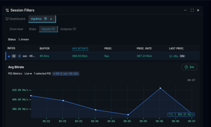
</figure>

The chart below the table plots one statistic for the selected PIDs.

Choose what the chart plots:

- click a column label, such as **AVG BITRATE**, to choose that statistic
- hover a value to see the related statistics of the same family, and click **+** next to one to plot it
- click the radio button at the left of a PID to add it to the chart or remove it

## Read the properties of a PID

<figure markdown="span">
  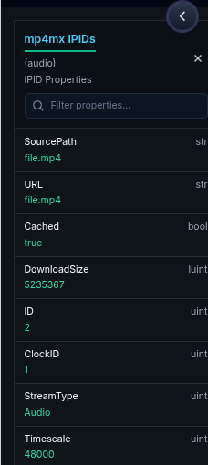
</figure>

Find a property of a PID:

1. click the eye icon of the PID: all its properties open at once
2. type in the search field to find one quickly, such as the timescale you know from your input file

The Outputs tab lists the PIDs the filter produces, with the same statistics. Comparing the two tabs of one filter tells you whether data enters it, and whether it leaves it.

See the properties of an output PID:

1. click the edge that leaves the filter
2. click the eye icon of the PID in the Inputs tab of the next filter

# 5. Preview the video of a PID {:data-level="all"}

The preview shows the video carried by a PID, decoded by your browser. It is available in live only.

You can open a preview in any layout, including the **Default** one, from the filter of the PID. The **Preview** layout is recommended: its **Previews** widget shows at once every PID you can preview, grouped by filter. You can also add **Previews** to any layout from **Widgets**.

Show the video of a PID from its filter:

1. open the Inputs or Outputs tab of the filter
2. click the camera icon of a video PID 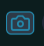{ style="height:1.8em; vertical-align:middle" }

The video appears in the filter. The camera icon is shown only on the PIDs you can preview. Click it again to close the preview.

Open a preview from the **Previews** widget:

1. open **Layouts** and choose **Preview**
2. click the eye icon of a PID under **Available**

The filter opens in its own widget, on its Inputs or Outputs tab, with the video. The PID moves under **Active**.

Only compressed video can be previewed, not raw video: AVC, HEVC if your browser supports it, and AV1. Otherwise the preview shows `Codec not supported by this browser`.

The session of this guide runs in real time (`reframer:rt=on`): the preview shows every frame. When a source runs more than 1.5 times faster than real time, only key frames are sent and a **Keyframes** badge appears on the preview (their rate, 10 or 30 per second, is set with **Keyframes/s** in the **Previews** widget only).

# 6. Check what GPAC reports {:data-level="all"}

The Logs counters in the header show the errors, warnings and info messages currently held by the monitor.

Display the messages of one level:

- click its counter in the header

The **System Logs** widget shows the corresponding messages.

<figure markdown="span">
  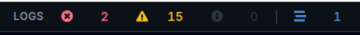
</figure>

See more about one part of GPAC:

1. open the gear icon of **System Logs**: every GPAC log tool is listed with its level
2. raise only the tool you are investigating, for example **Media** to **Info**, and leave the others at **Warning**

The header then shows the active configuration, here `all@warning:media@info`.

<figure markdown="span">
  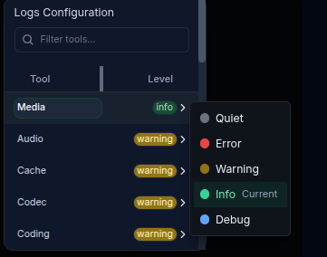
</figure>

# 7. Check resource usage {:data-level="all"}

**System Metrics** also gives the number of cores of the machine. Watch its trends while the session runs (refreshed every half second), for example how the CPU reacts when you change the encoding options of the same command.

!!! note

    On Linux, the CPU value reflects the load of the whole machine, not of the GPAC process only. The memory value is the peak used by the process since it started, so the curve never goes down, even when memory is released.

# 8. Keep your workspace {:data-level="all"}

Keep a layout for the next investigation:

1. move, resize, close or reopen the widgets until the layout suits the investigation
2. save it from **Layouts**
3. restore it from **Layouts** the next time you monitor the same kind of pipeline

<figure markdown="span">
  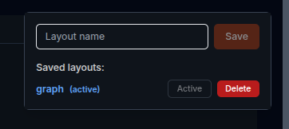
</figure>

# 9. Replay the session {:data-level="all"}

To inspect a session after it ends, record it with `-rmt-log` as described in [Session recording](remote-monitoring#session-recording).

Open the replay:

- click **History** in the header

The replay opens in a separate window, where some header controls are not available.

The **Select a session** window lists, under **From GPAC**, the recordings of the GPAC instance you are connected to; the recording in progress is marked.

Open a recording without a running GPAC:

- drag the folder given to `-rmt-log` onto **Drop a history folder**

<figure markdown="span">
  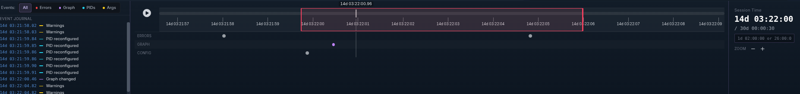
</figure>

The widgets show the session as it was at the cursor time. The timeline at the bottom of the window lets you move that cursor.

While replaying, use the same interface as in live: open a filter from the graph, read the statistics and properties of its PIDs, follow its logs. Only the video preview is not available.

## Play and move in time

Replay the session:

- click the play button to replay the session from the cursor, and click it again to pause
- click or drag the seek bar to jump to another time: the time under the pointer is shown above the bar

**Session time** shows the cursor time and the total duration of the recording.

Reach an exact time:

- type it in the field below **Session time**, for example `1d 02:00:00` or `26:00:00`

<figure markdown="span">
  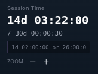
</figure>

## Zoom on a period

Show only one period:

1. click the time ruler under the seek bar: a red rectangle appears
2. drag its edges to choose the period, or drag it to move it
3. click **+** next to **Zoom**

<figure markdown="span">
  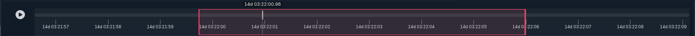
</figure>

While zoomed:

- drag the ruler to scroll through the session
- click **−** to zoom out
- click inside the rectangle to hide it

## Find an event

Under the ruler, the **Errors**, **Graph** and **Config** rows place the events of the session in time: errors and warnings, graph changes, PID reconfigurations and filter argument changes. A larger grey dot groups close events: zoom in to separate them.

Move the cursor to an event:

- click its dot on a row

<figure markdown="span">
  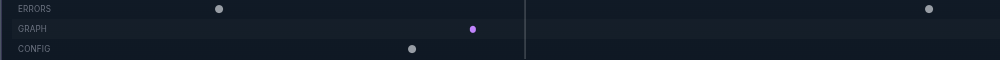
</figure>

The **Event Journal** on the left lists the events of the visible period.

Use the journal:

- click the time of an event to move the cursor there
- hover the time of an event to read its absolute time

<figure markdown="span">
  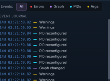
</figure>

Show one kind of event only, in the rows and in the journal:

- click **Errors**, **Graph**, **PIDs** or **Args** next to **Events:**
- click **All** to show them all again

**Errors** keeps the errors only, without the warnings shown on the **Errors** row.
